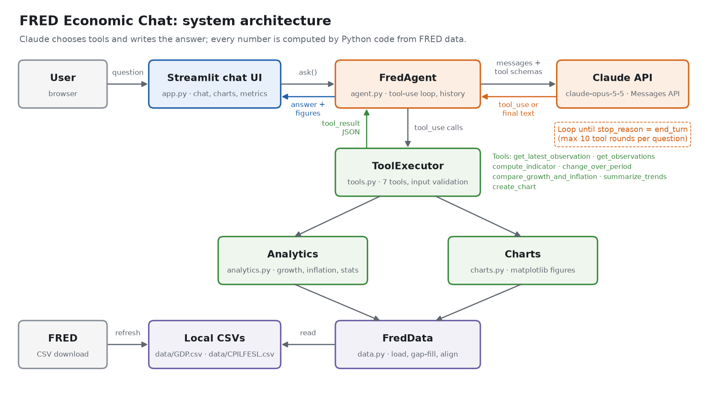

# FRED Economic Chat

A conversational AI app for exploring U.S. **GDP** and **Core CPI (CPILFESL)** data from FRED. You ask questions in plain English. Claude decides which calculations to run, Python tools compute the answers from the data, and Claude explains the results and draws charts when asked.



## Features

- Latest and historical observations for both series
- Economic indicators: GDP growth (YoY, QoQ annualized), core inflation (12-month, 3-month and 1-month annualized), change over any period, compound annual rates
- GDP growth vs. core inflation: correlations, lead/lag, regression, decade breakdown
- Six chart types, including a GDP growth vs. core inflation comparison with NBER recession shading
- A "How this was calculated" panel under every answer that lists the tool calls behind it
- One-click refresh from FRED (no FRED API key needed)

## Quick start

Requires Python 3.10+ and an [Anthropic API key](https://console.anthropic.com/).

```bash
python3 -m venv .venv && source .venv/bin/activate
pip install -r requirements.txt
cp .env.example .env        # then edit .env and set ANTHROPIC_API_KEY
streamlit run app.py
```

You can also paste the key into the app's sidebar instead of using `.env`.

## Project layout

```
app.py                      Streamlit chat UI
fred_chat/
  agent.py                  Claude tool-use loop, system prompt
  tools.py                  Tool schemas, validation, dispatch
  analytics.py              Growth, inflation, statistics, correlation
  charts.py                 matplotlib charts
  data.py                   CSV loading, FRED refresh, gap filling
data/                       GDP.csv, CPILFESL.csv (from FRED)
scripts/
  make_figures.py           Export standard charts to docs/figures/
  make_architecture_diagram.py
  run_samples.py            Run the sample questions, save transcripts
tests/                      pytest suite (no network or API key needed)
docs/
  technical_report.md       Implementation and findings
  architecture.md           Architecture diagram and component details
  figures/                  Charts and diagram
  sample_conversations/     Transcripts from run_samples.py
```

## Commands

```bash
python -m pytest -q                      # run tests
python scripts/make_figures.py           # regenerate charts
python scripts/run_samples.py            # sample conversations (uses the API)
```

## Configuration

| Variable | Default | Meaning |
|---|---|---|
| `ANTHROPIC_API_KEY` | none | Required to chat |
| `CLAUDE_MODEL` | `claude-opus-5-5` | Model ID |
| `CLAUDE_FALLBACKS` | `1` | Retry declined requests on a fallback model (`0` to disable) |

## Data notes

- GDP is **nominal** (current dollars), so its growth includes inflation.
- BLS did not publish October 2025 CPI because of the federal government shutdown. The app fills that month by log-linear interpolation and flags it in tool results and chart footnotes.

Sources: U.S. Bureau of Economic Analysis and U.S. Bureau of Labor Statistics, via [FRED](https://fred.stlouisfed.org/), Federal Reserve Bank of St. Louis.
