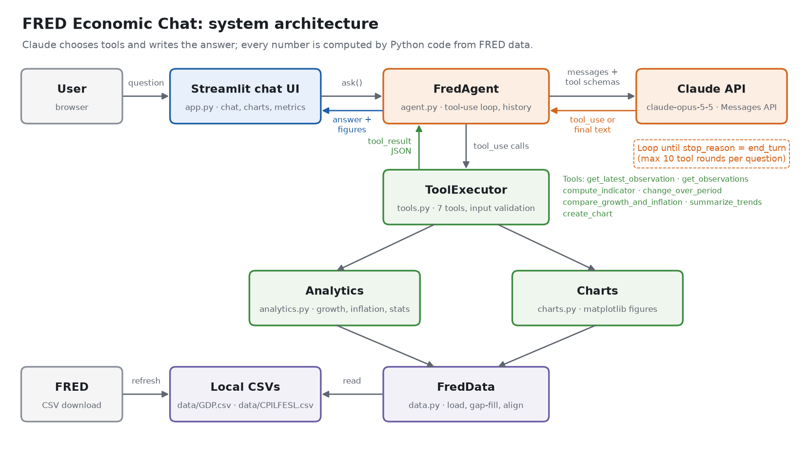
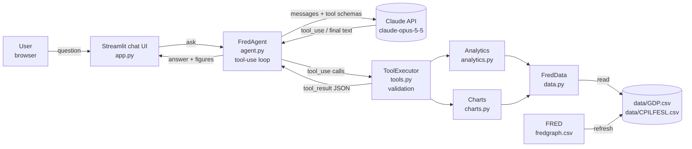

# System architecture

The PNG above is generated by `scripts/make_architecture_diagram.py`. The same structure in Mermaid:

## Request flow

1. The user types a question (or clicks a sample question) in the Streamlit UI.
2. `FredAgent.ask()` appends it to the conversation and calls the Claude Messages API with the system prompt, the conversation so far, and seven tool definitions.
3. Claude replies either with text (done) or with one or more `tool_use` blocks.
4. `ToolExecutor` validates each tool input against its JSON schema, runs the matching Python function, and returns the result as JSON in a `tool_result` block. Invalid inputs and errors go back as `is_error: true` results so Claude can correct itself.
5. Steps 2–4 repeat (up to 10 rounds) until Claude stops with `end_turn`.
6. The UI shows the final text, any charts the `create_chart` tool produced, and an expander listing every tool call that produced the numbers.

## Components

| Component | File | Responsibility |
|---|---|---|
| UI | `app.py` | Chat history, headline metrics, sample questions, data refresh, API key input, error messages |
| Agent | `fred_chat/agent.py` | System prompt, Messages API calls, tool-use loop, conversation history, token usage |
| Tools | `fred_chat/tools.py` | Tool JSON schemas, input validation, dispatch, data-quality notes |
| Analytics | `fred_chat/analytics.py` | Growth rates, inflation rates, windowing, statistics, correlation, lead/lag, decade summaries |
| Charts | `fred_chat/charts.py` | Six matplotlib chart types with NBER recession shading |
| Data | `fred_chat/data.py` | CSV loading, FRED refresh, regular date grid, gap filling |

## Tools available to Claude

| Tool | Purpose |
|---|---|
| `get_latest_observation` | Latest value, previous period, year-ago value, % changes; inflation rates for CPI; QoQ annualized growth for GDP |
| `get_observations` | Raw values over a window (auto-averaged to annual for long windows) |
| `compute_indicator` | One of 8 indicators over a window with summary statistics |
| `change_over_period` | Level change, total % change, compound annual rate, per-year growth or inflation |
| `compare_growth_and_inflation` | Correlations (Pearson, Spearman, excluding 2020–21), regression, lead/lag, by decade |
| `summarize_trends` | Decade averages, extremes, inflation peaks, latest readings |
| `create_chart` | Draws one of 6 chart types; the figure is shown to the user |
