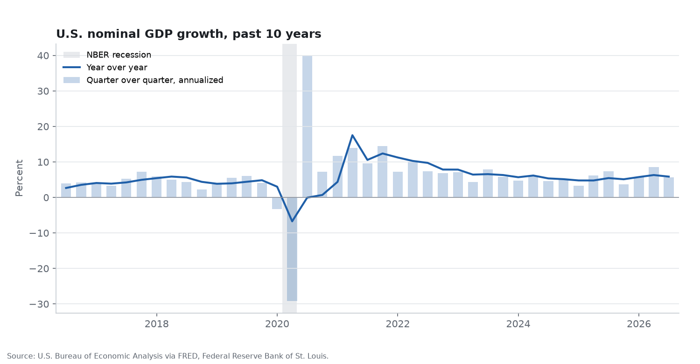
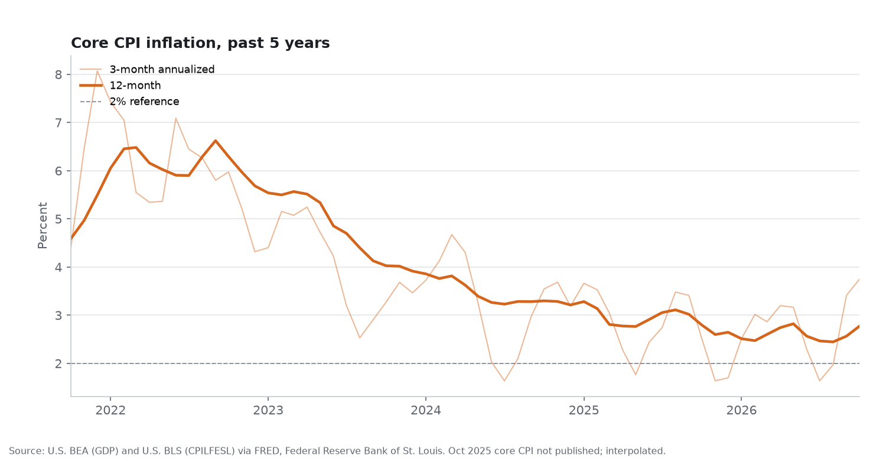
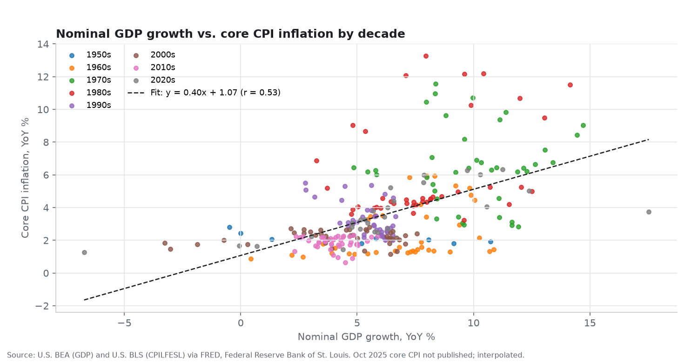
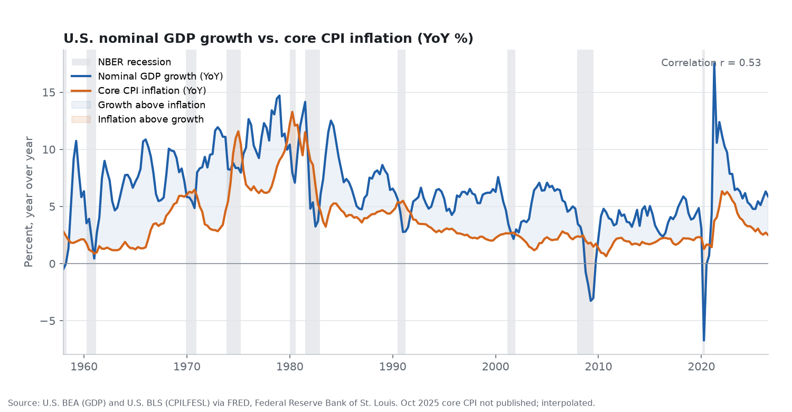
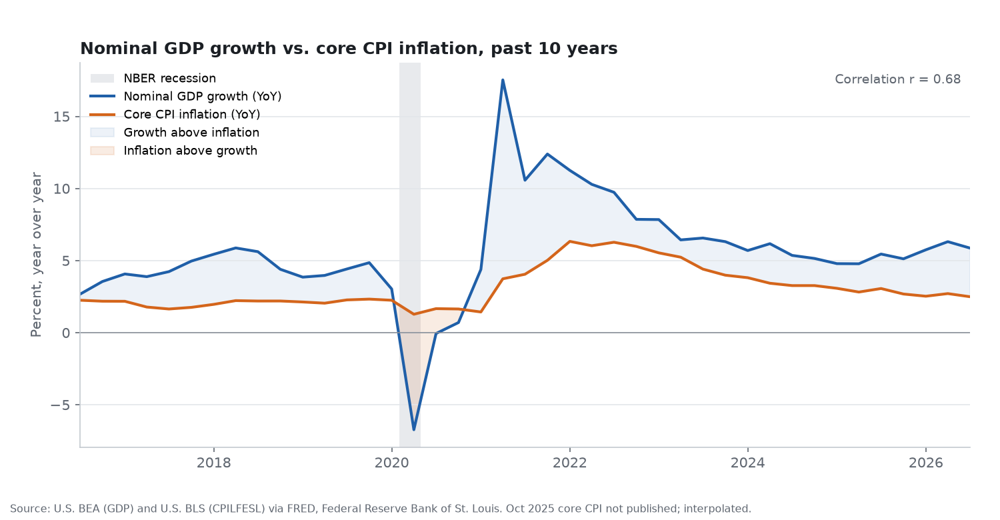
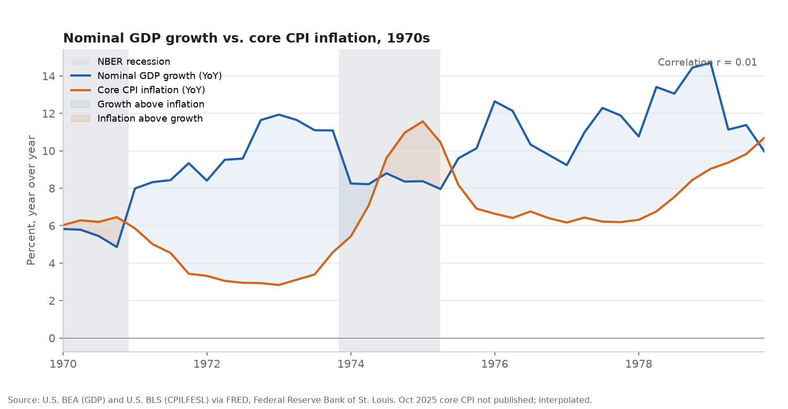

# Sample conversation

Generated 2026-11-14 20:08 with `claude-opus-5-5` (effort `medium`) as a single continuous chat, so later questions can refer to earlier answers.

## 1. What is the latest reported U.S. GDP?

**User:** What is the latest reported U.S. GDP?

**Assistant:**

The latest reported U.S. GDP is **$33.01 trillion** for **2026 Q3**. That figure is a seasonally adjusted annual rate in current dollars.

| Measure | Value |
|---|---|
| 2026 Q3 GDP | $33.01 trillion |
| 2026 Q2 GDP | $32.56 trillion |
| Growth from the previous quarter, annualized (the headline figure from the Bureau of Economic Analysis) | **5.61%** (1.37% not annualized) |
| Growth from a year earlier (vs. 2025 Q3, $31.18 trillion) | **5.87%** |

This is nominal GDP, so these growth rates include price increases as well as real output growth. Real (inflation-adjusted) GDP isn't in this data.

Tool calls

- `get_latest_observation` `{"series": "GDP"}`

## 2. How has U.S. GDP changed over the past 10 years?

**User:** How has U.S. GDP changed over the past 10 years?

**Assistant:**

Over the past 10 years, U.S. nominal GDP rose **about 75%**, from **$18.89 trillion in 2016 Q3 to $33.01 trillion in 2026 Q3**. That's an increase of $14.12 trillion, or a **compound annual rate of 5.74%**. All figures are seasonally adjusted annual rates in current dollars.

**Average growth from a year earlier, by year**

| Year | Avg. growth |
|---|---|
| 2016* | 3.11% |
| 2017 | 4.29% |
| 2018 | 5.33% |
| 2019 | 4.27% |
| 2020 | **−0.76%** |
| 2021 | **11.22%** |
| 2022 | 9.78% |
| 2023 | 6.79% |
| 2024 | 5.59% |
| 2025 | 5.04% |
| 2026* | 5.98% |

*The 10-year window only covers part of 2016 (Q3–Q4) and 2026 (Q1–Q3).

**The main points:**
- **Before the pandemic:** growth was steady at about 3–5% a year.
- **2020 pandemic drop:** GDP fell in 2020 Q1 and Q2, the only two quarters with declines in this period. In 2020 Q2 it was down 6.73% from a year earlier, or −29.11% on a quarterly annualized basis.
- **Rebound:** quarterly growth jumped to an annualized 39.86% in 2020 Q3. Growth from a year earlier peaked at 17.53% in 2021 Q2.
- **Since then:** growth has slowed back to about 5–6%. In 2026 Q3 it was 5.87% from a year earlier and 5.61% annualized from the previous quarter.

This is nominal GDP, so the high growth in 2021–22 partly reflects high inflation in those years, not just more output. The chart shows the year-over-year and annualized quarterly growth rates for the whole period.

Tool calls

- `change_over_period` `{"series": "GDP", "years_back": 10}`
- `create_chart` `{"chart_type": "gdp_growth", "years_back": 10, "title": "U.S. nominal GDP growth, past 10 years"}`

## 3. What is the current Core CPI inflation rate?

**User:** What is the current Core CPI inflation rate?

**Assistant:**

The current core CPI inflation rate is **2.77%** for **October 2026**, measured as the 12-month change. The core CPI index was 339.9 (1982–84 = 100), up from 330.73 in October 2025.

| Measure (October 2026) | Rate |
|---|---|
| 12-month change | **2.77%** |
| 3-month change, annualized | 3.75% |
| 1-month change, annualized | 3.61% (0.30% not annualized) |

**Recent months have been hotter:** the 3-month and 1-month annualized rates are both close to 3.6–3.8%, well above the 12-month rate. That suggests core inflation has picked up lately. If it continues at that pace, the 12-month rate would rise.

**Data note:** the government didn't publish October 2025 CPI because of the federal shutdown. That month's value of 330.73 was estimated from the months around it, so the 2.77% figure depends on an estimate and is approximate.

Tool calls

- `get_latest_observation` `{"series": "CPILFESL"}`

## 4. How has Core CPI inflation changed over the past five years?

**User:** How has Core CPI inflation changed over the past five years?

**Assistant:**

Over the past five years, core CPI inflation rose sharply, peaked in 2022, and then fell steadily. It went from **4.59% in October 2021** to a high of **6.62% in September 2022**, a low of **2.45% in August 2026**, and **2.77% in October 2026**. All rates are 12-month changes.

**12-month core inflation each December**

| Year | Rate |
|---|---|
| 2021 | 5.49% |
| 2022 | 5.69% |
| 2023 | 3.92% |
| 2024 | 3.21% |
| 2025 | 2.65% |
| 2026 (October) | 2.77% |

**The main points:**
- **Overall price increase:** the core CPI index rose **20.67%** in five years, from 281.67 to 339.90. That's about **3.83% a year**.
- **Average rate:** 12-month inflation averaged 4.08% over the period, with a median of 3.63%.
- **Lately:** inflation reached its five-year low in August 2026 and has edged up since. As noted earlier, the 3-month annualized rate (3.75%) is above the 12-month rate, which points to some recent pickup.

The chart shows both the 12-month and 3-month annualized rates for the whole period.

**Data note:** the October 2025 value was estimated because the government didn't publish it during the shutdown. That affects the 12-month rates around late 2025 and October 2026, but only slightly.

Tool calls

- `change_over_period` `{"series": "CPILFESL", "years_back": 5}`
- `create_chart` `{"chart_type": "core_inflation", "years_back": 5, "title": "Core CPI inflation, past 5 years"}`

## 5. What is the relationship between GDP growth and Core CPI inflation?

**User:** What is the relationship between GDP growth and Core CPI inflation?

**Assistant:**

From 1958 Q1 to 2026 Q3 (275 quarters), GDP growth and core CPI inflation have a **moderate positive relationship**. The correlation is **0.53**: periods of faster nominal GDP growth have tended to have higher inflation. But the relationship is loose and changes a lot from decade to decade.

**Key numbers (growth from a year earlier, quarterly data)**
- **Averages:** GDP growth averaged 6.38%, core inflation 3.65%, and the gap between them averaged 2.72%. That gap is a rough stand-in for real growth.
- **Excluding the pandemic:** without 2020–21 the correlation is about the same (0.54), so those unusual swings don't drive the result.
- **Fitted line:** each extra 1 percentage point of GDP growth goes with about 0.40 points more core inflation.
- **Timing:** the link is strongest when inflation is compared with GDP growth from **about 4 quarters earlier** (correlation 0.63). Inflation tends to follow faster growth with a delay.

**The relationship varies by decade**

| Decade | Avg. GDP growth | Avg. core inflation | Correlation |
|---|---|---|---|
| 1960s | 6.94% | 2.46% | 0.39 |
| 1970s | 9.97% | 6.49% | 0.01 |
| 1980s | 7.98% | 6.07% | 0.35 |
| 1990s | 5.50% | 3.22% | −0.58 |
| 2000s | 4.20% | 2.17% | 0.14 |
| 2010s | 4.06% | 1.85% | −0.03 |
| 2020s | 6.24% | 3.63% | **0.68** |

Most of the long-run link comes from the **level** of both series: high-inflation decades (the 1970s and 1980s) also had high nominal growth. Within a single decade, the two often don't move together, and sometimes move in opposite directions (as in the 1990s). The 2020s show the strongest link because the pandemic recovery pushed both up at the same time.

**Two caveats:**
1. **Part of the link is built in.** This is nominal GDP, so its growth already includes price increases. Some positive correlation is guaranteed.
2. **Correlation isn't causation.** The 4-quarter delay fits the idea that strong demand later pushes up prices, but this data alone can't prove that.

**Latest (2026 Q3):** GDP growth was 5.87% and core inflation 2.49%, a gap of 3.37%. The 2.49% is core CPI averaged over the quarter, which is why it differs from the 2.77% figure for October alone. The October 2025 CPI value was estimated, which affects these numbers only slightly.

The chart plots each quarter's GDP growth against core inflation, colored by decade, with the fitted line (slope 0.40, r = 0.53).

Tool calls

- `compare_growth_and_inflation` `{}`
- `create_chart` `{"chart_type": "growth_vs_inflation_scatter", "title": "Nominal GDP growth vs. core CPI inflation by decade"}`

## 6. Generate a visualization comparing GDP growth and Core CPI inflation over time.

**User:** Generate a visualization comparing GDP growth and Core CPI inflation over time.

**Assistant:**

I made two charts comparing nominal GDP growth and core CPI inflation. Both use quarterly data and measure each series as the % change from a year earlier.

**Chart 1: full history, 1958 Q1–2026 Q3** (correlation 0.53)
- **Gap between the lines:** GDP growth is usually above core inflation. The two averaged 6.38% and 3.65%, and the gap between them roughly reflects real growth.
- **1970s–80s:** both lines are at their highest. The 1970s averaged 9.97% GDP growth and 6.49% core inflation. These decades produce most of the long-run link.
- **1990s–2010s:** both lines drift lower and move more independently. In the 2010s, core inflation averaged 1.85% and GDP growth 4.06%.
- **2020s:** GDP growth plunges and then spikes during the pandemic, and core inflation rises sharply afterward.

**Chart 2: past 10 years, 2016 Q3–2026 Q3** (correlation 0.68)
- **2020:** GDP growth fell to −6.73% in 2020 Q2, then jumped to 17.53% in 2021 Q2.
- **Inflation's delayed rise:** core inflation climbed after the GDP rebound. The monthly 12-month rate peaked at 6.62% in September 2022, which fits the roughly 4-quarter delay noted earlier.
- **Since 2023:** both lines have come down. In 2026 Q3, GDP growth was 5.87% and core inflation 2.49%, a gap of 3.37%.

This is nominal GDP, so its growth already includes price increases, and some co-movement is built in. Correlation alone doesn't show that one causes the other. The October 2025 core CPI value was estimated because of the government shutdown, which affects the late-2025 and 2026 points only slightly.

Tool calls

- `create_chart` `{"chart_type": "growth_vs_inflation", "title": "U.S. nominal GDP growth vs. core CPI inflation (YoY %)"}`
- `create_chart` `{"chart_type": "growth_vs_inflation", "years_back": 10, "title": "Nominal GDP growth vs. core CPI inflation, past 10 years"}`

## 7. Summarize the key economic trends observed in both datasets.

**User:** Summarize the key economic trends observed in both datasets.

**Assistant:**

Both series show the same broad pattern: a high-inflation era in the 1970s–80s, a long calm period from the 1990s to 2010s, and a pandemic-era jump followed by a cool-down. Today, GDP growth is solid and core inflation is just under 3%, but the past few months have been firmer.

**GDP (nominal, current dollars), 1947 Q1–2026 Q3**
- **Long-run growth:** GDP grew from $0.24 trillion to **$33.01 trillion**, about **6.37% a year**.
- **By decade:** growth peaked in the 1970s (9.97% average) and slowed to about 4% in the 2000s and 2010s. In the 2020s it's back up to 6.24%.
- **Biggest swings:** the worst quarter was 2020 Q2 (−29.11% annualized), followed by 2008 Q4 (−7.58%). The best was 2020 Q3 (+39.86%).
- **Recently:** annualized quarterly growth was 3.67% in 2025 Q4, 5.76% in 2026 Q1, 8.49% in Q2 and 5.61% in Q3. Growth from a year earlier was 5.87% in 2026 Q3.

**Core CPI, January 1957–October 2026**
- **Long-run inflation:** the index rose from 28.5 to 339.9, about **3.62% a year**.
- **Peaks:** the highest was 13.6% in June 1980, followed by 11.86% in February 1975. The most recent peak was **6.62% in September 2022**.
- **Low-inflation era:** inflation bottomed at 0.6% in October 2010. Since 2010, 41.6% of months have had inflation below 2%.
- **Now:** **2.77%** in October 2026, about the same as a year earlier (2.80%). The 3-month annualized rate is higher at **3.75%**, a sign of recent pickup.

**How the two relate**
- **Correlation:** moderately positive at 0.53. The link mostly reflects shared highs and lows across decades, and inflation tends to follow GDP growth by about a year.
- **Real growth gap:** GDP growth minus core inflation has averaged 2.72%. In 2026 Q3 it was 3.37%, above the long-run average.
- **Built-in overlap:** nominal GDP growth includes inflation, so part of the correlation is automatic.

**Limits:** this data has no real GDP, employment or interest rates. The gap between GDP growth and core inflation is only a rough stand-in for real growth. The October 2025 CPI value was estimated because of the government shutdown, which affects the recent inflation figures only slightly.

Tool calls

- `summarize_trends` `{}`

## 8. And how does that compare with the 1970s?

**User:** And how does that compare with the 1970s?

**Assistant:**

Today looks much calmer than the 1970s. In the 1970s, nominal GDP growth and core inflation were both far higher, inflation came in two big waves and ended the decade above 11%. Now both are lower and steadier.

**1970s vs. today** (growth and inflation measured against a year earlier)

| Measure | 1970s | 2020s so far | Latest |
|---|---|---|---|
| Avg. GDP growth | **9.97%** | 6.24% | 5.87% (2026 Q3) |
| Avg. core inflation | **6.49%** | 3.62% | 2.77% (October 2026) |
| Peak core inflation | **11.86%** (February 1975) | 6.62% (September 2022) | — |
| GDP growth minus inflation (rough real-growth stand-in) | 3.49% avg., **−0.73% in 1979 Q4** | — | 3.37% (2026 Q3) |
| Correlation, GDP growth vs. inflation | **0.01** | 0.68 | — |

**What stands out about the 1970s**
- **Two inflation waves.** Core inflation fell to a low of 2.53% in January 1973, then rose to 11.86% in February 1975. It eased to about 6–7% in 1976–77, then climbed again to **11.32% by December 1979**. It reached its all-time high of 13.6% in June 1980, just after the decade ended.
- **Inflation kept rising at the end of the decade.** Today, core inflation has fallen back to about 2.8% after its 2022 peak. In the 1970s, the first peak was followed by an even bigger second one.
- **Inflation hid weak growth.** Annualized quarterly GDP growth never fell below 0.94% (in 1970 Q4) and averaged 10.21%, peaking at 25.54% in 1978 Q2. Much of that was price increases. By 1979 Q4, core inflation (10.7%) was higher than GDP growth (9.97%), which suggests real output was barely growing, if at all.
- **Inflation followed growth with a long delay.** In the same quarter, the two series were essentially uncorrelated (0.01). But GDP growth predicted inflation about **8 quarters later** (correlation 0.81), a longer delay than the roughly 4 quarters in the full history.

**Similarities to today:** both periods had an inflation spike above 6%. The recent 3-month annualized rate of 3.75% is a reminder that progress against inflation can stall, as it did after 1976. But so far the 2020s peak was much lower than in the 1970s and has faded more clearly.

The chart shows GDP growth and core inflation over 1970–79, with the two inflation waves.

**Limits:** this is nominal GDP, and real GDP, unemployment and interest rates aren't in this data. So I can't confirm recessions or policy effects directly. The estimated October 2025 CPI value only affects the "latest" column, and only slightly.

Tool calls

- `compare_growth_and_inflation` `{"start_date": "1970-01", "end_date": "1979-12"}`
- `compute_indicator` `{"indicator": "core_inflation_yoy", "start_date": "1970-01", "end_date": "1979-12"}`
- `compute_indicator` `{"indicator": "gdp_growth_qoq_annualized", "start_date": "1970Q1", "end_date": "1979Q4"}`
- `create_chart` `{"chart_type": "growth_vs_inflation", "start_date": "1970Q1", "end_date": "1979Q4", "title": "Nominal GDP growth vs. core CPI inflation, 1970s"}`

## 9. What is the current unemployment rate?

**User:** What is the current unemployment rate?

**Assistant:**

I can't answer that from this data. I only have two series: **nominal GDP** and **core CPI**. Unemployment isn't included, and I don't want to quote a figure from memory that might be wrong or out of date.

The official U.S. unemployment rate is published monthly by the Bureau of Labor Statistics in its Employment Situation report. It's also on FRED under the series code **UNRATE**.

Here's what I can show you from this data instead:
- **Growth:** the latest quarter (2026 Q3) was up 5.61% annualized from the previous quarter and 5.87% from a year earlier. That's solid nominal growth.
- **Inflation:** core inflation was 2.77% in October 2026, with a firmer 3-month annualized rate of 3.75%.
- **A rough real-growth figure:** GDP growth minus core inflation was 3.37% in 2026 Q3, a loose stand-in for real growth.

---

Totals: 17 API calls; input tokens: 52 uncached, 17,646 written to cache, 139,077 read from cache; 7,317 output tokens.
