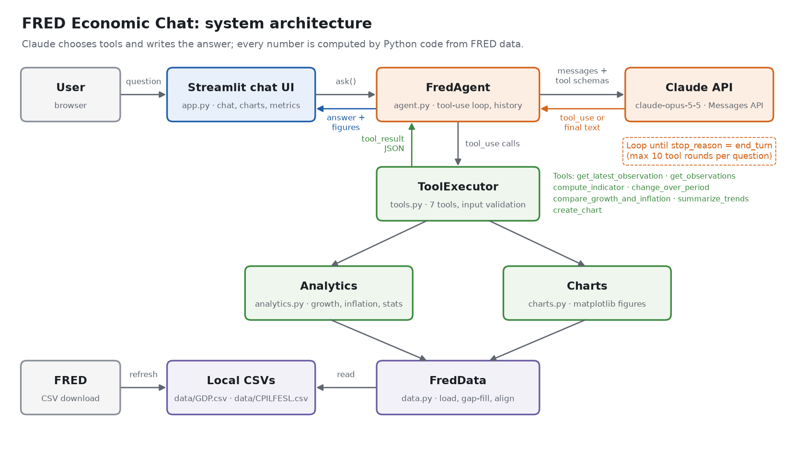
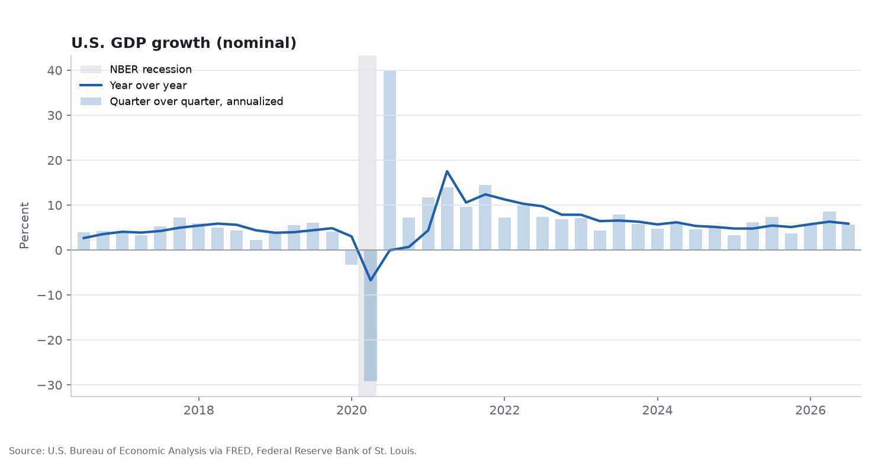
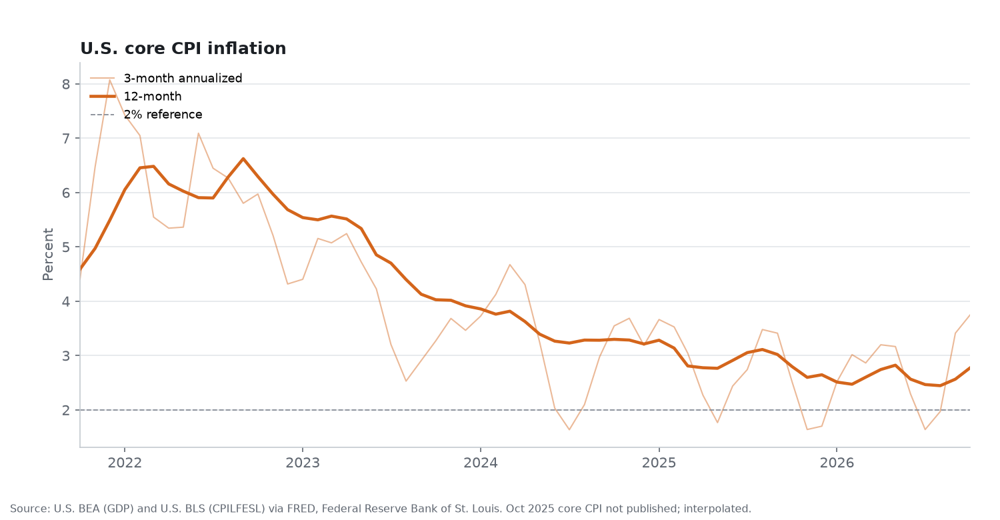
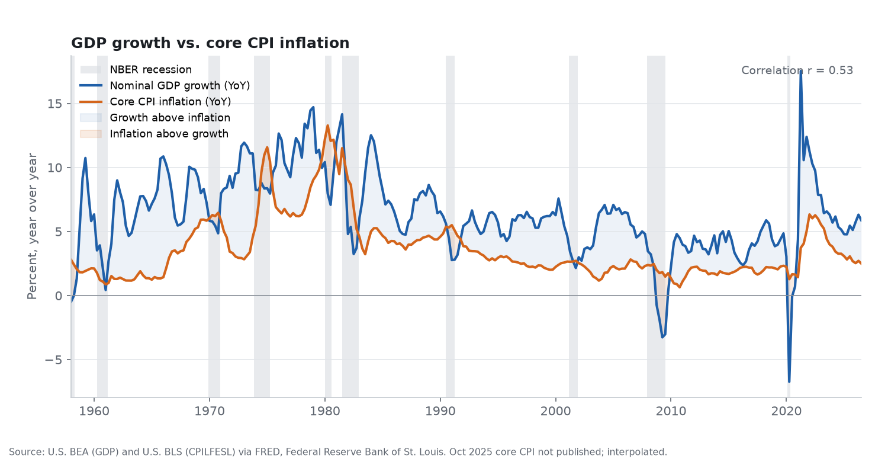
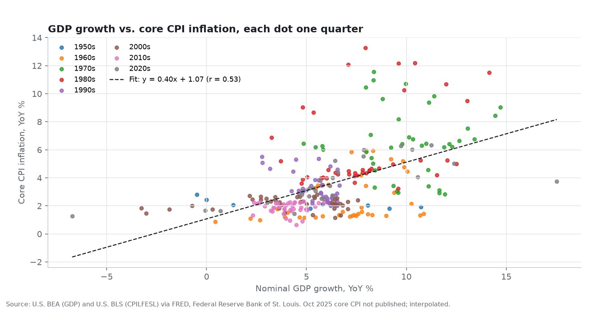

# FRED Economic Chat: technical report

## 1. Overview

FRED Economic Chat is a conversational app for exploring two U.S. economic series from the Federal Reserve Bank of St. Louis's FRED database:

- **GDP**: Gross Domestic Product, billions of dollars, seasonally adjusted annual rate, quarterly (1947 Q1 – 2026 Q3).
- **CPILFESL**: Consumer Price Index for All Urban Consumers, All Items Less Food and Energy ("core CPI"), index 1982–84 = 100, seasonally adjusted, monthly (Jan 1957 – Oct 2026).

Users ask questions in plain English, such as "How has Core CPI inflation changed over the past five years?" Claude (`claude-opus-5-5`) works out what to calculate, calls Python tools that do the calculations on the data, and explains the results. When asked, it also draws charts.

The core design rule is that **the language model never produces numbers on its own**. Every value, growth rate, correlation and date in an answer comes from a tool result computed with pandas. The model's job is to understand the question, choose the right calculation, and explain the result clearly.

## 2. Architecture



The app has four layers (see [architecture.md](architecture.md) for details):

1. **Presentation** (`app.py`, Streamlit): chat interface, headline metrics, sample-question buttons, "Refresh data from FRED", and a per-answer "How this was calculated" panel listing the tool calls.
2. **Agent** (`fred_chat/agent.py`): a tool-use loop over the Claude Messages API.
3. **Tools** (`fred_chat/tools.py`): seven tools with JSON schemas, input validation, and dispatch.
4. **Analytics, charts and data** (`analytics.py`, `charts.py`, `data.py`): pure Python and pandas, independent of the LLM and fully unit-tested.

## 3. Implementation

### 3.1 Data layer

- `load_series` reads `data/<SERIES>.csv`. It accepts both column names FRED has used for the date (`observation_date` and `DATE`) and treats blank or `.` values as missing.
- `refresh_from_fred` downloads `https://fred.stlouisfed.org/graph/fredgraph.csv?id=<SERIES>`, which needs no API key. It checks the file before overwriting the local copy, so a failed download leaves the existing data untouched.
- **Gap handling.** The CPILFESL file has no value for **October 2025**: BLS did not publish October 2025 CPI because of the federal government shutdown. Year-over-year calculations that count back a fixed number of rows would silently compare against the wrong month (for example Oct 2026 against Sep 2025). To prevent this, each series is put on a complete date grid (`asfreq("MS")` / `asfreq("QS")`). The single missing month is filled by log-linear interpolation, which is the geometric mean of September and November 2025. Every filled date is recorded, and a `data_note` is attached to every CPI-related tool result and chart footnote. The system prompt tells Claude to mention this when it affects the numbers. Without the fill, the latest core inflation would show 2.87% (October 2026 compared with September 2025). With it, the rate is 2.77%.

### 3.2 Economic calculations (`analytics.py`)

| Measure | Definition |
|---|---|
| GDP growth, YoY | `GDP_t / GDP_{t-4} − 1` (quarterly) |
| GDP growth, QoQ annualized | `(GDP_t / GDP_{t-1})^4 − 1`, the BEA headline convention |
| Core inflation, 12-month | `CPI_t / CPI_{t-12} − 1` |
| Core inflation, 3-month / 1-month annualized | `(CPI_t / CPI_{t-3})^4 − 1`, `(CPI_t / CPI_{t-1})^12 − 1` |
| Quarterly core inflation | Monthly CPI averaged to calendar quarters (an incomplete final quarter is dropped), then YoY |
| Real growth proxy | Nominal GDP growth YoY minus core inflation YoY (a rough proxy; official real GDP uses the GDP deflator) |
| Change over a period | Start/end values, total % change, compound annual rate |
| Relationship | Pearson and Spearman (rank) correlation; Pearson excluding 2020–21; OLS slope; lead/lag correlations at −8…+8 quarters; correlation by decade |

Time windows accept `start_date`/`end_date` (`YYYY`, `YYYY-MM`, `YYYY-MM-DD`, `YYYYQn`) or `years_back`, which counts back from the latest observation. So "the past 10 years" of GDP means 2016 Q3 to 2026 Q3.

### 3.3 Tools and validation

Each tool has a JSON schema with enums for series, indicator and chart type, and `additionalProperties: false`. Before running any tool, `validate_input` checks for unknown arguments, missing required arguments, wrong types and invalid enum values. Errors go back to Claude as `tool_result` blocks with `is_error: true`, and the model usually corrects the call on the next round. Long series are averaged to annual values before being returned, which keeps tool results compact.

### 3.4 Agent loop (`agent.py`)

- **Model and settings:** `claude-opus-5-5` with adaptive thinking and `effort: "medium"`. Medium effort is enough to plan a few tool calls without the latency of deeper reasoning.
- **Loop:** call the Messages API; if `stop_reason == "tool_use"`, run every `tool_use` block and send all results back in a single user message; repeat until `end_turn`. The loop is capped at 10 rounds per question.
- **History integrity:** a turn is committed to the conversation only if it ends cleanly. A refusal, a truncated tool call, or hitting the round cap leaves the history unchanged, so the next request is always valid.
- **Refusal fallback:** requests go through the beta endpoint with `fallbacks: "default"` (`server-side-fallback-2026-07-01`). If the primary model declines, the API retries on a fallback model in the same call. Setting `CLAUDE_FALLBACKS=0` turns this off.
- **Prompt caching:** top-level `cache_control: {type: "ephemeral"}` caches the stable prefix (tools, system prompt, earlier turns). Later rounds in the same question and later questions read that prefix from cache.
- **System prompt:** tells the model to get every number from tools; defines the default meanings of "current inflation", "GDP growth" and "past N years"; requires periods and units in answers; explains the nominal-GDP caveat; and says to call `create_chart` for visualization requests. It also tells the model to say so plainly when a question is outside the data (for example unemployment).

### 3.5 User interface

The Streamlit page shows four headline metrics computed directly (no LLM): latest GDP, GDP growth QoQ annualized, core inflation 12-month, and core inflation 3-month annualized. The chat panel renders markdown answers and matplotlib charts. Under each answer, an expander lists the tool calls with their arguments, so a reader can check where every number came from. The sidebar shows data coverage, the interpolation note, the FRED refresh button, the seven sample questions as buttons, a clear-conversation button, and token usage.

### 3.6 Testing

`pytest` runs 23 tests with no network access or API key:

- **Data:** complete date grids, the October 2025 fill sits between its neighbours, and the interpolation is a geometric midpoint.
- **Calculations:** YoY compares the same month a year earlier; latest GDP and QoQ annualized growth match hand calculations; the 10-year window and compound rate are correct; date parsing; partial-quarter dropping.
- **Indicators and charts:** every indicator and every chart type runs.
- **Tools:** validation rejects bad enums, wrong types and extra arguments.
- **Agent loop (scripted fake client):** tool round then answer; both tool results go back in one message; request parameters (model, adaptive thinking, effort, fallbacks, no forced `tool_choice`); bad tool input becomes an error result; a refusal does not change history; history carries across turns.

## 4. Findings

All figures below come from the app's own tools on the bundled data (GDP through 2026 Q3, core CPI through October 2026). Charts are in [`docs/figures/`](figures/).

### 4.1 GDP

- **Latest:** $33.01 trillion (SAAR) in 2026 Q3, up from $32.56T in Q2. That is **5.6% annualized** quarter over quarter and **5.9%** year over year.
- **Past 10 years (2016 Q3 → 2026 Q3):** from $18.89T to $33.01T, **+74.7%**, a compound rate of **5.7% per year** in nominal terms. The only quarters that shrank were 2020 Q1 and 2020 Q2; Q2 was −29.1% annualized, the worst quarter in the whole series. That was followed by the strongest, +39.9% in 2020 Q3. YoY growth peaked at 17.5% in 2021 Q2 during the reopening, then settled to about 5–6% from 2024 to 2026.
- **Long run:** nominal GDP grew at 6.4% a year from 1947 to 2026. Decade averages peaked in the 1970s (10.0% YoY, inflated by high prices), fell to about 4% in the 2000s and 2010s, and rose to 6.2% so far in the 2020s.



### 4.2 Core CPI inflation

- **Current:** **2.77%** over the 12 months to October 2026 (index 339.9). The 3-month annualized rate is higher at **3.75%**, which suggests some short-term firming after a low of 2.45% in August 2026.
- **Past five years (Oct 2021 → Oct 2026):** core inflation rose from 4.6% to a peak of **6.62% in September 2022**, the highest since 1982. It then eased steadily: December readings were 5.7% (2022), 3.9% (2023), 3.2% (2024) and 2.65% (2025). Over the five years the core price level rose 20.7%, or 3.8% a year.
- **Long run:** core inflation averaged 3.6% a year since 1957. It peaked at 13.6% in June 1980 and bottomed at 0.6% in October 2010. In 42% of months since 2010 it was below 2%.



### 4.3 Relationship between GDP growth and core inflation

- Over 1958–2026 (275 quarters), nominal GDP growth and core inflation have a **moderate positive correlation, r = 0.53** (Spearman 0.53). Excluding the 2020–21 pandemic swings barely changes it (0.54). The fitted slope is 0.40: on average, a 1-point-higher GDP growth rate goes with core inflation about 0.4 points higher.
- **Inflation lags growth.** The correlation is strongest when inflation is shifted about **four quarters after** GDP growth (r = 0.63 vs. 0.53 at the same time). This fits the common pattern of strong demand feeding into prices with a delay.
- **The relationship is not stable over time.** By decade the correlation ranges from −0.58 (1990s: strong growth with falling inflation) through about 0 (1970s and 2010s) to +0.68 (2020s, when the pandemic shock and reopening moved both together).
- **Important caveat:** this GDP series is nominal, so its growth already includes inflation, and part of the correlation is mechanical. Nominal growth minus core inflation, a rough real-growth proxy, averaged 2.7 points over the full period and was 3.4 points in 2026 Q3.





### 4.4 Summary of trends

1. The economy has grown steadily in nominal terms, with sharp but short contractions in 2008–09 and 2020.
2. Core inflation was above 6% in three periods: 1969–71, 1974–82 (peaking at 13.6% in June 1980) and 2022. Each was followed by a long period of disinflation.
3. After the 2022 peak, core inflation fell back toward the high-2% range by 2025–26, but the most recent 3-month rate (3.75%) is above the 12-month rate.
4. Nominal GDP growth has stayed around 5–6%, well above core inflation, which implies positive real growth of roughly 3%.

## 5. Sample conversations

`scripts/run_samples.py` runs the seven required questions, plus a follow-up and an out-of-scope question, as one continuous chat. It writes the transcript to [`docs/sample_conversations/conversation.md`](sample_conversations/conversation.md), each chart to `docs/sample_conversations/charts/`, and a JSON record with the tool calls and token usage.

## 6. Limitations and future work

- **Nominal GDP only.** Adding real GDP (`GDPC1`) and the GDP deflator would allow a proper real-growth analysis instead of the core-CPI proxy.
- **Correlation only.** No causal model; a VAR or Phillips-curve style regression would be a natural extension.
- **Revisions.** FRED values are the latest vintage; GDP is revised, and ALFRED vintages could show real-time vs. revised views.
- **Charts are static** (matplotlib). Plotly would allow hover and zoom.
- **Single-user session state.** Conversation history lives in the Streamlit session and is lost on reload.

## 7. How to run

```bash
uv venv -p 3.12 .venv && uv pip install -p .venv/bin/python -r requirements.txt   # or: python -m venv .venv && pip install -r requirements.txt
cp .env.example .env   # then put your ANTHROPIC_API_KEY in .env
.venv/bin/streamlit run app.py
.venv/bin/python -m pytest -q
.venv/bin/python scripts/make_figures.py
.venv/bin/python scripts/run_samples.py
```
